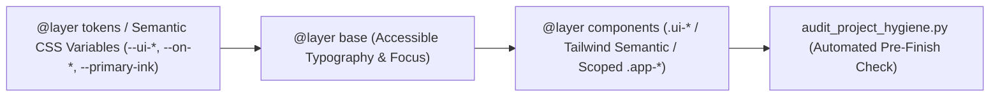

# Master AI Error Registry & Stack-Agnostic Zero-Conflict Rules (`v5.0.0`)

> [!IMPORTANT]
> Synced across [AGENTS.md](../rules/AGENTS.md) (`v5.0.0`) and [GEMINI.md](./GEMINI.md) (`v3.0.0`) — 100% first-party, stack-agnostic (Tailwind + shadcn/ui, React/Next.js, Laravel Blade, Vue/Svelte, Vanilla CSS, or Bootstrap), verified with **`0 errors, 0 warnings`**.

---

## 1. Zero-Conflict Token & `@layer` CSS Architecture

- **Token Core ([keith-ui-tokens.css](../ui-kit/keith-ui-tokens.css)):** Defines `--ui-canvas`, `--ui-surface`, `--ui-surface-subtle`, `--ui-border`, `--ui-ink`, `--ui-ink-muted`, `--ui-primary`, `--on-primary`, and `--primary-ink` verified `>= 4.5:1` WCAG AA across **all 15 presets** in Light & Dark modes.
- **Settings Drawer ([keith-ui-settings.js](../ui-kit/keith-ui-settings.js)):** Zero-jQuery Vanilla ES6 right-side theme & layout drawer (`Light/Dark`, `15 Swatches`, `Vertical/Horizontal`, `Sidebar Mode`, `Font`, `Reset`) backed by a single state store.
- **Component Catalog ([00-MASTER-SCREEN-AND-COMPONENT-TYPES.md](../component-catalog/00-MASTER-SCREEN-AND-COMPONENT-TYPES.md)):** 18 screen archetypes and 38+ component types usable in **any UI framework**.

---

## 2. Complete Registry of 24 Common AI Coding Errors & Preventive Rules

| # | Common AI Mistake | Preventive Rule Enforced |
|---|---|---|
| 1 | Unscoped global tag/framework overrides + `!important` wars in custom CSS | Use `@layer` + `.app-*` namespace with semantic CSS variables; zero `!important`. |
| 2 | Hardcoding `#000`, `#fff`, `#f8f9fa` inside components | Bind all surfaces, borders, text, and accents to `--ui-*` / Tailwind semantic tokens. |
| 3 | Unpaired `text-dark`, `text-black`, `bg-white`, `bg-light`, or inline color `style="..."` | Banned without dark tokens; use `bg-card text-foreground` or `.ui-subtle-box`. |
| 4 | Dark Mode turning default sidebar/header text black-on-dark | Handled by `--on-sidebar` / `--on-header` / `--on-brand` semantic tokens. |
| 5 | Forcing `#ffffff` text on light/yellow/teal primary buttons | Solid primary fills use `--on-primary`; links/outlines/soft badges use `--primary-ink` (`>= 4.5:1`). |
| 6 | Blanket `svg path { fill }` wiping out multi-color brand logos | Never override all SVG paths; target only `currentColor` icons. |
| 7 | Competing `localStorage` vs cookie resetting theme preferences | Single state store (`keith_ui_preferences_v1`) shared by header toggle and drawer. |
| 8 | Missing component variants or omitting Right-Side Settings Drawer on admin shells | Map screens from `component-catalog/00`–`07` + mount settings drawer on admin shells. |
| 9 | Seeding sample/dummy records, fake charts, `Lorem ipsum`, or AI corporate jargon | Strict zero sample data (`0` / `₱0.00` + `EmptyState`) and simple everyday English words. |
| 10 | Invalid/inaccessible HTML (`javascript:void(0)`, `<button>` inside `<a>`, missing `aria-label`, `outline: none`, missing `<th scope="col">`) | `<button type="button">`, `aria-label`, `:focus-visible` ring, `<th scope="col">`, `aria-live="polite"`. |
| 11 | Missing `Loading` / `Empty` / `Error` states or double-submit bugs | Complete states on every view + in-flight submit button lock (`disabled` + `aria-busy="true"`). |
| 12 | Overflowing mobile tables, clipped bottom-row dropdowns, or media CLS | `overflow-x-auto`, upward-safe `dropup` menus, `tabular-nums`, explicit `width`/`height` or `aspect-ratio`. |
| 13 | Vague placeholder identifiers (`data`, `items`, `temp`, `res`, `handleData`, `Box1`) | Strict domain-specific `camelCase`, `is/has/can/should`, `handle*`, `PascalCase`, `.app-*`. |
| 14 | Over-abstracting static one-off labels (`BTN_SAVE`) OR inline magic numbers | Extract magic numbers, limits, status maps, and shared error messages into `UPPER_SNAKE_CASE`; keep one-off labels inline. |
| 15 | Volatile `.env` ports/versions in file headers, 300-line functions, or dead code / `console.log` | 2–3 line purpose header, `<40` line single-purpose functions, ordered imports, zero dead code. |
| 16 | Unversioned static assets or mismatched `VERSION` vs `plugin.json` | `?v=X.Y.Z` asset cache busting and validator-checked SemVer sync. |
| 17 | Floating-point money math (`0.1 + 0.2`) or trusting client-sent `price` / `total` / `role` | Server-side RBAC + exact money math in integer centavos or `DECIMAL(12,2)` inside DB transactions. |
| 18 | SQL/shell string interpolation, N+1 query loops, or unindexed foreign keys | Prepared statements / ORM bindings only, eager loading, explicit FK `ON DELETE` + indexes, UTC dates. |
| 19 | Silent empty `catch (e) {}` blocks, missing startup `.env` checks, or leaked stack traces | Fail-fast `.env` validation on boot, server-side logging, and plain user error responses. |
| 20 | Unvalidated file uploads or hard-deleting financial records | Server MIME + max-byte check + safe generated filename; soft-void financial rows with reason. |
| 21 | Exposing secrets/API keys in code, logs, or `NEXT_PUBLIC_*` / `VITE_*` variables | Secrets strictly in gitignored `.env` with `.env.example` placeholders. |
| 22 | Running `migrate:fresh`, `DROP TABLE`, `TRUNCATE`, or live VPS edits without backup | Explicit user approval + verified timestamped `.sql` / `.bak.YYYYMMDD-HHMM` backup first. |
| 23 | Reloading Nginx/PHP-FPM/SSH without syntax check or locking out SSH/web ports | Mandatory `nginx -t` / `php-fpm -t` before reload; preserve ports `22`, `80`, `443`. |
| 24 | Claiming code was "tested and verified" without running real checks | Execute real syntax checks (`node --check` / `php -l` / `tsc --noEmit`) + `audit_project_hygiene.py`. |
