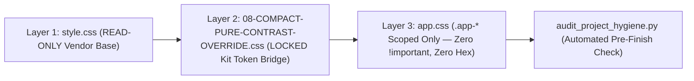

# Master AI Error Registry & Zero-Conflict Rules (`v4.0.0`)

> [!IMPORTANT]
> All rules, semantic token stylesheets, skills, subagents, and automated validators are synced and verified with **`0 errors, 0 warnings`** across [AGENTS.md](../rules/AGENTS.md) and [GEMINI.md](./GEMINI.md) (`v2.5.0`).

---

## 1. Zero-Conflict 3-Layer CSS Architecture

- **Layer 1 (`style.css`):** Read-only vendor stylesheet. Never edited.
- **Layer 2 ([08-COMPACT-PURE-CONTRAST-OVERRIDE.css](../component-catalog/08-COMPACT-PURE-CONTRAST-OVERRIDE.css)):** Copied untouched into every project. Defines semantic tokens (`--kit-canvas`, `--kit-surface`, `--kit-surface-subtle`, `--kit-border`, `--kit-ink`, `--kit-ink-muted`, `--on-primary`, `--primary-ink`, `--on-sidebar`, `--on-header`, `--on-nav-header`) verified >= `4.5:1` WCAG AA across all 15 presets and Light/Dark modes.
- **Layer 3 (`app.css`):** Strictly `.app-*` domain classes only — zero `!important`, zero raw `#hex`, zero Bootstrap/template selectors.

---

## 2. Complete Registry of 24 Common AI Coding Errors & Preventive Rules

### A. CSS, Theme & Contrast Conflicts
| # | Common AI Mistake | Preventive Rule Enforced |
|---|---|---|
| 1 | Writing `body`, `h1..h6`, `.card`, `.btn`, `[data-*]` overrides + `!important` inside project `app.css` | `app.css` is strictly locked to `.app-*` classes with zero `!important` (enforced by [audit_project_hygiene.py](../scripts/audit_project_hygiene.py)). |
| 2 | Hardcoding `#000`, `#fff`, `#f8f9fa` inside custom components | Custom CSS must consume `var(--kit-*)` and `var(--primary)` tokens only. |
| 3 | Putting `text-dark`, `text-black`, `bg-white`, `bg-light`, or inline color `style="..."` in HTML/EJS/Blade/JSX | Banned in markup (Bootstrap's `!important` breaks Dark Mode & dark swatches); use `.kit-subtle-box`, `.kit-muted`, or `.badge.light`. |
| 4 | Ignoring Dark Mode + default `color_1` (`color_1` turns `#212130` dark navy in Dark Mode, causing black-on-dark text) | Locked token bridge switches `--on-sidebar` / `--on-header` / `--on-nav-header` to `#ffffff` on `[data-theme-version="dark"][data-*="color_1"]`. |
| 5 | Forcing `#ffffff` text on all primary buttons/active pills (`color_1`/`3` teal `1.88:1`, `color_7` yellow `1.63:1`, `color_8` white `1.00:1`) | Solid primary surfaces bind to `var(--on-primary)`; links/outlines/light badges bind to `var(--primary-ink)` (all 45 combinations >= `4.5:1`). |
| 6 | Blanket `svg path { fill: ... !important }` wiping out multi-color brand logos | Never override all SVG paths; target only `.svg-title-path` or `currentColor` strokes. |
| 7 | Two competing theme stores (`localStorage` vs `demo.js` cookies) resetting UI Kit settings on reload | `demo.js` cookies (`getCookie('version')` / `setCookie('version', ...)`) are the single source of truth. |

### B. UI, HTML, Responsive & Accessibility Mistakes
| # | Common AI Mistake | Preventive Rule Enforced |
|---|---|---|
| 8 | Inventing a flat custom layout or forgetting the Right-Side UI Kit Settings Panel | Mandatory Bootstrap 5 Dashboard Pro shell + `demo.js` & `styleSwitcher.js` right-side drawer on every page. |
| 9 | Seeding sample/dummy records, fake charts, `Lorem ipsum` / `Dompet`, or corporate AI jargon | Strict zero sample data (`0` / `₱0.00` + `EmptyState`) and simple everyday English words. |
| 10 | Invalid/inaccessible HTML (`javascript:void(0)`, `<button>` inside `<a>`, missing `aria-label`, `outline: none`, missing `<th scope="col">`) | Semantic `<button type="button">`, `aria-label` on icon buttons, `:focus-visible` ring, `<th scope="col">`, `aria-live="polite"`. |
| 11 | Missing `Loading` / `Empty` / `Error` states or unlocked submit buttons allowing double-POST | Complete states required on every view + in-flight submit button lock (`disabled` + `aria-busy="true"`). |
| 12 | Overflowing tables on mobile, clipped bottom-row dropdowns, or media layout shift (CLS) | `.table-responsive`, upward-safe `dropup` menus, `tabular-nums`, and explicit `width`/`height` or `aspect-ratio`. |

### C. Naming, File Structure & Code Bloat Mistakes
| # | Common AI Mistake | Preventive Rule Enforced |
|---|---|---|
| 13 | Vague placeholder identifiers (`data`, `items`, `temp`, `res`, `handleData`, `Box1`, `.custom`) | Strict domain-specific `camelCase`, `is/has/can/should`, `handle*`, `PascalCase`, `.app-*`. |
| 14 | Over-abstracting static one-off labels (`BTN_SAVE = 'Save'`) OR scattering magic numbers inline | Extract magic numbers, limits, status maps, and shared error messages into `UPPER_SNAKE_CASE`; keep static single-language labels inline in markup. |
| 15 | Putting volatile `.env` ports/versions in file headers, 300-line functions, or leaving `console.log` / dead code | Concise 2–3 line purpose header (no volatile config), `<40` line single-purpose functions, ordered imports, zero dead code/debug logs. |
| 16 | Broken relative `@import` font paths, unversioned CSS/JS cache issues, or mismatched `VERSION` vs `plugin.json` | Verified asset URLs, `?v=X.Y.Z` cache busting, and validator-checked SemVer sync. |

### D. Backend, Money, Database & Security Mistakes
| # | Common AI Mistake | Preventive Rule Enforced |
|---|---|---|
| 17 | IEEE-754 floating-point money math (`0.1 + 0.2`) or trusting client-sent `price` / `total` / `role` | Server-side RBAC + exact money math in integer centavos or `DECIMAL(12,2)` inside DB transactions. |
| 18 | SQL/shell string interpolation, N+1 query loops, or unindexed foreign keys | Prepared statements / ORM bindings only, eager loading (`with()`), explicit FK `ON DELETE` + indexes, UTC ISO-8601 timestamps. |
| 19 | Silent empty `catch (e) {}` blocks, missing startup `.env` checks, or raw stack traces sent to users | Fail-fast `.env` validation on boot, server-side error logging, and clean user-facing error responses. |
| 20 | Unvalidated file uploads or hard-deleting financial/payout records | Server MIME + max-byte check + safe generated filename; soft-void financial rows with reason & UTC timestamp. |
| 21 | Exposing secrets/API keys in code, logs, or `NEXT_PUBLIC_*` / `VITE_*` client variables | Secrets strictly in gitignored `.env` with `.env.example` placeholders. |

### E. Live VPS, Deployment & Verification Mistakes
| # | Common AI Mistake | Preventive Rule Enforced |
|---|---|---|
| 22 | Running `migrate:fresh`, `DROP TABLE`, `TRUNCATE`, or live VPS edits without backup | Explicit user approval + verified timestamped `.sql` / `.bak.YYYYMMDD-HHMM` backup first. |
| 23 | Reloading Nginx/PHP-FPM/SSH without syntax check or locking out SSH/web ports | Mandatory `nginx -t` / `php-fpm -t` before reload; preserve ports `22`, `80`, `443`. |
| 24 | Claiming code was "tested and verified" without running real checks | Must execute syntax checks (`node --check` / `php -l`) + `audit_project_hygiene.py` in session before reporting pass. |
