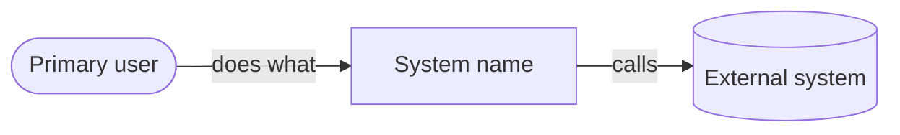
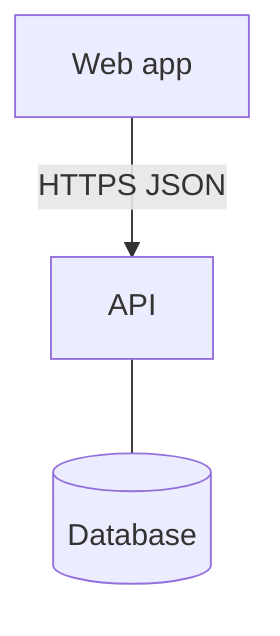

<!-- AGKIT2 2.8.0 planning scaffold. Keep machine-readable IDs/fields and use only relevant content. Replace illustrative rows and examples with the actual brief. Do not invent evidence, approvals, dates or locale-specific obligations. Shared core/design/verification rules govern decisions and checks; this template adds no universal approval or task-count gate. -->

# Architecture

## Context and drivers

<!-- Link important requirements and quality drivers to actual constraints. Describe existing and target behavior for brownfield work. -->
## System context (C4 level 1)

<!-- Show people, external systems and important flows. Keep the diagram readable; do not add actors to reach a node count. -->

## Containers (C4 level 2)

<!-- Show the deployable units the solution actually needs. A static site does not need a separate API, worker and database merely because the scaffold illustrates them. -->

| Container | Responsibility | Technology |
|---|---|---|
| | | |

## Components

<!-- Detail boundaries where it reduces implementation ambiguity. Say inapplicable when the system is simple rather than inventing layers. -->
## Integrations

<!-- List actual external contracts, trust, data, failure and fallback behavior. Provider-specific capability/cost claims require current evidence. -->
| System | Direction | Protocol and auth | Data | Failure mode and fallback |
|---|---|---|---|---|
| | | | | |

## Key flows

<!-- Explain critical paths, retries, consistency and recovery where relevant. Choose detail from the risk, not a fixed flow count. -->
## Technology stack

<!-- Tie choices to current project constraints and team needs. Preserve a suitable existing stack; references do not mandate dependencies. -->
| Concern | Choice | Reason |
|---|---|---|
| | | |

## Cross-cutting concepts

<!-- Describe only relevant shared behavior: identity, errors, logging, time, money, localization and storage. Use the actual audience timezone/currency, not a sample default. -->
## Architecture decisions

<!-- Link real ADRs with truthful proposed/accepted status. Routine delegated choices do not require a separate user approval ceremony. -->
| ADR | Decision | Status |
|---|---|---|
| ADR-001 | | proposed |

## Deployment view

<!-- Identify actual execution locations and operational boundaries, with details in 09 for the full set. -->
## Technical risks and debt

<!-- Expose consequences of the chosen boundaries and a validation/mitigation path; link managed risks where defined. -->
## Data model summary

<!-- LITE ONLY: summarize actual entities, keys, constraints and lifecycle. Full mode moves detail to 04 and removes duplicate definitions. -->
## API summary

<!-- LITE ONLY: define API IDs once in this table and link served R IDs. Full mode defines endpoints in 05 instead. Do not invent an API for an API-free product. -->
| ID | Method and path | Purpose | Role | Serves |
|---|---|---|---|---|
| API-01 | | | | R-001 |
