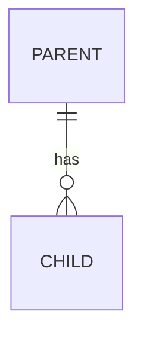

<!-- AGKIT2 2.8.0 planning scaffold. Keep machine-readable IDs/fields and use only relevant content. Replace illustrative rows and examples with the actual brief. Do not invent evidence, approvals, dates or locale-specific obligations. Shared core/design/verification rules govern decisions and checks; this template adds no universal approval or task-count gate. -->

# Data Model

## Conventions

<!-- Choose naming, IDs, time handling, monetary representation and deletion behavior from actual engine and product constraints. Explain exposed/offline IDs; do not prescribe UUIDs, soft deletion or a locale universally. -->
## Entities

<!-- Define each actual entity in the product vocabulary and link its requirements. -->
## Entity relationship diagram

<!-- Show relationships and cardinality consistent with the tables and product rules. -->

## Tables

<!-- Keep columns, indexes and constraints consistent. Enforce durable integrity where practical and identify transaction/concurrency invariants. -->
### table_name

| Column | Type | Null | Default | Notes |
|---|---|---|---|---|
| id | bigint identity | no | | primary key |

Indexes:

Constraints:

## Enumerations and reference data

<!-- State valid values, ownership and change behavior where relevant; fixtures must be deterministic and free of production secrets. -->
## Data lifecycle and retention

<!-- Specify purpose, retention, deletion/archive behavior and verified applicable obligations. Distinguish a proposal from a legal requirement. -->
| Data | Retention | Reason | Disposal |
|---|---|---|---|
| | | | |

## Personal data inventory

<!-- List actual sensitive/personal fields, purpose and access boundaries for the security/UX owners. Do not collect data because the template suggests it. -->
## Volumes and growth

<!-- Use observed or explicitly estimated workloads and representative queries. Label uncertainty; avoid invented precise growth forecasts. -->
## Migrations and seed data

<!-- Describe compatibility, ordering, backfill validation and recovery. Application rollback does not restore deleted data; applying live changes needs actual authorization. -->
