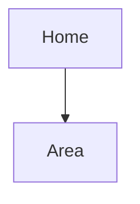

<!-- AGKIT2 2.8.0 planning scaffold. Keep machine-readable IDs/fields and use only relevant content. Replace illustrative rows and examples with the actual brief. Do not invent evidence, approvals, dates or locale-specific obligations. Shared core/design/verification rules govern decisions and checks; this template adds no universal approval or task-count gate. -->

# UX

## Users and contexts

<!-- Use relevant actual roles, devices, environment and accessibility needs from the brief. Distinguish assumptions from user research. -->
## Design direction

<!-- Record the chosen visual direction (ask once only if genuinely unclear) and useful qualities of references; no repeated intake for maintenance or per worker. Final tokens belong in DESIGN.md where useful. Styles, motion, density and imagery are choices, not universal bans or quotas. -->
## Information architecture

<!-- Group actual screens/navigation around the primary tasks and roles. Do not create extra pages merely to populate a sitemap. -->

## User journeys

<!-- Describe important end-to-end tasks and recovery paths, with relevant screens and data dependencies. No journey quota applies. -->
## Screen inventory

<!-- Define S IDs once in the first column. Include relevant loading, empty, invalid, offline, denied and partial states rather than every state on every screen. -->
| ID | Screen | Route | Roles | Serves | States |
|---|---|---|---|---|---|
| S-01 | | | | R-001 | |

## Key flows

<!-- Show important actions, permission decisions, errors and recovery. Add confirmation only where consequence/reversibility justifies it. -->
## Wireframe specs

<!-- Describe purpose, regions, prioritized content/actions and state changes enough for implementation. Responsive behavior follows actual content/device needs; preserve the accepted visual direction. -->
### Wireframe: S-01 <Screen name>

## Content and microcopy

<!-- Use truthful, specific copy and the accepted brand voice. Apply actual languages, timezone/currency and glossary terms without importing the example locale. -->
## Accessibility target

<!-- State the relevant target and verification method. Include semantics, focus, keyboard, readability and reduced motion where applicable; accessibility requirements do not dictate a visual style. -->
